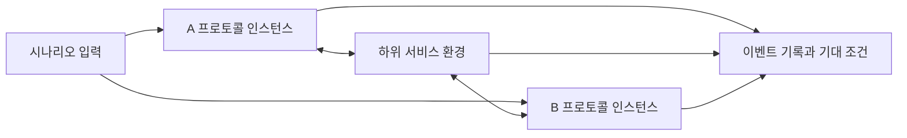

# 계층별 프로토콜 모델과 결정적 시뮬레이션 설계

상태: Accepted
기준일: 2026-10-30
구현 상태: P6까지 가상 엔진·실제 폼·장애 환경·표준 예제와 IndexedDB 저장·기록 탐색/snapshot 재실행을 구현했다. 최종 응답성·지원 브라우저·CI 검증은 P7 범위다. 실행 세부 규칙은 [P0 계약](p0-execution-contract.md), 정의·인코딩은 [P1 계약](p1-models-codecs.md), 실제 엔진은 [P2 계약](p2-runtime.md)을 따른다.

## 문제와 목표

[제품 명세](../product-specs/protocol-simulator-v1.md)의 V1-001~007을 단계별로 구현한다. 현재 구현 경로는 [Architecture](../../ARCHITECTURE.md)를 따른다. 응용·전송 계층의 프로토콜을 각각 정의하고, 하위 서비스의 보장과 환경 조건을 바꾸어 결과와 원인을 확인하게 한다. 한 실행에서 여러 사용자 계층을 조합하거나 실제 네트워크에 접속하지 않는다.

## 제안 구조와 계약

### 실험 구성

계층은 역할을 설명하고 하위 서비스 계약은 호환성을 결정한다. 응용 계층 = 요청·응답 또는 스트림 사용이라는 고정 대응은 두지 않는다. HTTP/1.1 예제는 스트림, TCP 연결 예제는 데이터그램 환경을 사용한다. 서비스 보장을 바꾸면 다른 실험 환경으로 취급한다.

### 데이터 소유권

| 데이터 | 주요 내용 | 소유권·생명주기 |
| --- | --- | --- |
| ProtocolDefinition | ID·revision·계층, 하위 서비스 요구, 형식·코덱, 상태·변수·규칙, 출처·지원 범위 | 편집 초안. 실행 시작 시 고정 사본을 생성 |
| EnvironmentDefinition | 서비스 타입, 방향별 전달 조건·청크·연결 이벤트 | 실험 설정. 프로토콜 규칙과 별도 관리 |
| ScenarioDefinition | 최초·후속 상위 입력과 시각, 장애 대상, 관찰 기간, 기대 조건 | 실험 설정. 일반 환경 확률과 특정 장애를 구분 |
| Experiment | A·B 프로토콜 revision, 환경, 시나리오, seed | 실행 구성의 기준 단위 |
| RunSnapshot | 사용한 모든 정의의 실제 내용, schemaVersion, engineVersion, seed | 실행 시작 이후 불변. 참조 원본을 편집·삭제해도 보존 |
| ParticipantState | 상태, 변수, 수신 버퍼, 활성 타이머 | 실행별·참여자별 격리. 같은 정의를 사용해도 공유하지 않음 |
| EventTrace | runId·eventId·가상 시각·순번, 원인 ID, 참여자·방향, 데이터, 규칙 ID, 상태·변수 변화 | 엔진이 추가. UI가 수정하지 않음 |
| RunResult | 실행 종료 사유, 진단, 기대 조건별 통과·실패·미판정 | 해당 snapshot과 기록에만 유효 |

ID는 안정적으로 유지하고 revision은 실행에 사용하는 정의 내용을 구분한다. 재생은 EventTrace의 저장된 상태를 조회하며 실제 엔진을 과거로 되돌려 외부 효과를 취소하는 기능이 아니다. 결정적 비교는 생성 시각·임의 runId 같은 메타데이터를 제외한 의미적 기록을 비교한다.

### 프로토콜과 하위 환경 인터페이스

- 프로토콜은 `stream` 또는 `datagram`을 요구하고 실행 전에 환경과 호환성을 검사한다.
- 프로토콜은 상위 입력, 하위 수신, 연결 상태, 타이머 이벤트를 받는다. 선언형 규칙은 상태·타입·조건을 검사한 뒤 명시된 순서로 동작한다.
- 환경은 프로토콜의 메시지 의미나 ACK를 해석하지 않는다. 바이트 또는 논리 패킷의 전달·장애만 담당한다.
- 전송 프로토콜에 넣는 상위 데이터는 시나리오가 공급한다. 상위로 전달한 결과도 검증한다. 실제 응용 계층 실행기를 연결하지 않는다.
- 상태·타이머·정수 변수와 보관한 페이로드를 지원해 순서 번호와 재전송을 표현한다. 사용자 코드·eval·동적 네트워크 호출은 없다.
- 조건이 두 개 이상 일치하면 임의로 첫 규칙을 고르지 않는다. 명확한 정적 충돌은 정의 검사에서, 입력에 따라 드러난 충돌은 실행 진단에서 멈추고 관련 규칙을 표시한다.
- 일치 규칙이 없을 때는 진단 후 해당 참여자의 처리를 중단한다. 무시가 필요한 프로토콜은 명시적인 무시 규칙을 정의한다. 종료 상태의 후속 입력 처리도 같은 원칙을 따른다.

### 형식·코덱과 메시지 경계

도메인의 메시지 정의와 바이트/패킷 코덱을 분리한다. 전송 기록에는 구조화된 값과 실제 처리한 바이트 또는 개념 패킷을 구분해서 표시한다.

| 코덱 | v1 계약 |
| --- | --- |
| JSON Lines stream | JSON 메시지 뒤 LF로 경계 표시. 수신 바이트를 누적해 완전한 한 줄만 파싱. 분할된 UTF-8 문자와 여러 메시지 합쳐 읽기 지원 |
| JSON datagram | 한 데이터그램의 페이로드가 하나의 완전한 JSON 메시지. 서로 다른 패킷을 자동으로 이어 붙이지 않음 |
| 구조화된 전송 패킷 | 선언된 필드와 payload를 갖는 논리 패킷. 실제 바이너리 TCP/IP 헤더 직렬화로 표시하지 않음 |
| HTTP/1.1 예제 | 요청/상태 줄, 헤더 종료, Content-Length 기준 본문을 바이트 단위로 해석하는 제한된 전용 코덱 |

본문 길이는 문자 수가 아닌 바이트 수로 검사한다. HTTP 예제는 GET·POST, origin-form, 필수 Host, 명시적인 Content-Length를 사용하는 제한된 요청·응답을 지원한다. chunked, pipelining, informational response, TLS와 전체 표준 호환성은 제외한다. 중복·충돌하는 길이 헤더와 지원하지 않는 전송 형식은 명확히 거부하고 일반 HTTP 전체에 대한 판정으로 표현하지 않는다.

TCP 예제는 CLOSED/LISTEN → SYN-SENT/SYN-RECEIVED → ESTABLISHED의 정상 연결 수립과 SYN·ACK·seq·ack 핵심 필드에 한정한다. TCP 자체는 신뢰성 있는 순서 보장 바이트 스트림을 제공하지만 이 예제가 데이터 전송·재전송·흐름 제어를 모두 구현한다는 뜻은 아니다. 제한된 모델에서의 시간 초과는 시나리오 진단으로 표시한다. [TCP 서비스 계약](https://www.rfc-editor.org/rfc/rfc9293.html#section-2.2), [연결 수립](https://www.rfc-editor.org/rfc/rfc9293.html#section-3.5), [HTTP/1.1 형식](https://www.rfc-editor.org/rfc/rfc9112.html#section-2).

### 결정적 실행

단일 가상 시계와 이벤트 큐를 사용한다. 규칙 처리 한 번은 동기적인 원자 단계이며 생성한 전송·타이머 이벤트를 같은 큐에 넣는다. wall-clock 시간, UI 재생 속도와 전역 난수는 프로토콜 결과에 영향을 주지 않는다.

P0에서 `(가상 시각, 이벤트 우선순위, 생성 순번)` 정렬을 확정하고 기초 comparator 테스트를 추가했다. 같은 시각에는 시나리오 입력·전달·연결 이벤트를 생성 순번으로 처리한 뒤 타이머 만료를 처리한다. 따라서 목표 엔진에서는 기한과 정확히 같은 시각에 완전히 수신된 유효한 응답이 만료 전에 타이머를 취소할 수 있다. 실제 타이머 처리 검증은 P2다.

타이머는 참여자·이름·generation으로 식별한다. 재시작·취소 후 큐에 남아 있는 이전 generation의 만료는 실행하지 않는다. 초기화·새 실행은 runId를 바꾸며 이전 실행의 UI callback·worker 결과는 반영하지 않는다. 엔진 구현은 우선 단일 실행 문맥을 가정하고 worker 도입은 P7의 응답성 측정으로 판단한다.

seed와 버전이 고정된 PRNG를 사용하고 알고리즘·호출 순서 변경 시 engineVersion을 바꾼다. 중단한 실행을 seed만으로 이어 붙이지 않는다. 일시정지한 같은 인스턴스를 재개하거나 snapshot으로 처음부터 재실행한다.

### 하위 환경 처리

스트림은 방향별로 전송 바이트를 누적하고 수신 청크를 나누거나 같은 전달 배치의 여러 write를 합친다. 최종 바이트 순서와 중복 없는 전달을 유지한다. 연결 실패 시 이미 전달된 접두부는 유지하고 나머지는 명시적인 오류와 함께 종료한다. 정상 EOF가 와도 코덱 버퍼에 미완성 메시지가 남으면 불완전 메시지로 진단한다. 수신 청크는 실제 TCP 세그먼트나 메시지와 동일시하지 않는다.

데이터그램은 전송 방향·원본 전송 순번을 기준으로 특정 손실 규칙을 먼저 적용한다. 해당 규칙이 없는 전송에 seed 기반 손실·중복·지연을 적용한다. 지연은 0 미만이 되지 않게 하고 각 패킷의 전달 시각 차이로 순서 역전을 표현한다. 중복 사본은 다시 중복 확률에 투입하지 않으며 각 사본에 원본 이벤트 ID를 남긴다. 최초 전송과 재전송은 서로 다른 전송 순번을 가진다.

특정 패킷 손실과 확률 설정이 동시에 있으면 적용 순서와 판정 결과를 기록한다. 샘플링·청크 분할 방식과 단위는 [P0 계약](p0-execution-contract.md)에 고정했다. 실제 환경 구현은 P4이며 이후 계약 변경은 호환성 변경으로 관리한다.

### 종료·관찰·상한

실행 생명주기는 idle, running, paused와 terminal 상태 completed/cancelled/invalid/limit-reached/engine-error로 구분한다. 프로토콜의 Failed 상태나 timeout 이벤트는 실행 엔진 자체의 실패와 구분한다. 기대 조건 결과는 pass/fail/undetermined다.

시나리오는 가상 관찰 기간과 최대 이벤트 수를 가진다. 종료 상태 도달만으로 관찰을 조기 종료하지 않고, 중복 전달 없음 같은 조건은 관찰 기간 전체를 평가한다. 큐가 일찍 비어도 정해진 관찰 종료까지 추가 이벤트가 없음을 기록하고 판정할 수 있다. 파싱·규칙 오류가 관찰을 방해하면 영향받은 조건은 미판정으로 남긴다.

이벤트 수·메시지/버퍼 크기·기록 크기에 유한 상한을 둔다. P0는 실행당 10,000 이벤트, 단일 메시지와 참여자 수신 버퍼 각각 1 MiB, 기록 16 MiB를 기본값으로 고정해 snapshot에 포함한다. 실제 강제 적용은 후속 엔진 구현에서 검증하고 P7에서 브라우저 응답성과 함께 조정한다. 상한 변경은 snapshot에 기록한다. 0ms 무한 전이, 끝없는 재시도와 미완성 프레임 누적도 상한 안에서 정지해야 한다. 수동 중단·상한 초과는 성공으로 보지 않는다.

### 저장·가져오기

정의·실험·snapshot·결과는 별도 소유 데이터다. P6에서 native IndexedDB를 선택했으며 transaction/revision·실패 복구와 파일 검증은 [P6 계약](p6-persistence-replay.md)을 따른다. 파일 bundle은 schemaVersion과 필요한 정의 내용을 포함하며, 원본 예제·참조 정보도 보존한다.

가져오기는 임시 메모리에서 전체 구조·타입·용량·참조·버전을 검증한 뒤 적용한다. ID 충돌 시 기본은 새 사본 생성이며 기존 실험을 조용히 덮어쓰지 않는다. 참조 중인 정의 삭제는 막거나 실험을 명시적으로 정리하도록 안내하고 과거 실행 snapshot은 유지한다. 잘못된 초안은 저장 가능하지만 실행 가능한 유효 상태와 구분한다.

## 제안 모듈과 의존 방향

아래는 v1의 모듈 책임이다. P0~P7에서 이 경로를 구현했으며 현재 실제 경로·추가 검증/CI 도구는 Architecture를 따른다. 소규모 단일 프로젝트로 시작하고 공용 패키지나 backend는 만들지 않는다.

| 제안 경로 | 책임 |
| --- | --- |
| `src/domain/` | 선언형 모델, 타입·참조·서비스 호환성 검사 |
| `src/codecs/` | 형식별 인코딩·프레이밍·점진적 디코딩 |
| `src/engine/` | 가상 시계·큐·규칙 실행·타이머·기록·기대 조건 |
| `src/environments/` | 주입받은 큐·난수로 스트림/데이터그램 전달 모델 구현 |
| `src/application/` | 초안과 실행 snapshot 분리, 시작·정지·재실행과 저장 조정 |
| `src/examples/` | 버전이 있는 예제 정의, 지원 범위, fixture |
| `src/persistence/` | 로컬 저장·bundle 검증·가져오기·내보내기 |
| `src/ui/` | 작업 공간·폼·시퀀스·상태·진단·접근성 |
| `tests/unit/`, `tests/integration/`, `tests/e2e/` | 각 계약의 단위, 통합, 실제 브라우저 사용자 흐름 검증 |

UI → application → domain/engine/codecs/environments/persistence 방향을 유지한다. engine·환경·코덱은 UI나 브라우저 저장 API를 참조하지 않는다. engine은 주입된 서비스 포트에 의존하고 구체적인 환경 조합은 application이 담당한다. 테스트가 DOM 없이 코어를 실행할 수 있어야 한다.

## 실패와 복구

| Flow | 실패 시 응답 | 상태·stale 방지 | 재시도·복구 |
| --- | --- | --- | --- |
| 초안 실행 | 정의 위치와 오류 표시 | snapshot 생성 전 검사, 초안 유지 | 수정 후 새 실행 |
| 전달·타이머 | 환경 처리와 timeout 원인 표시 | runId, 전송 원인 ID, timer generation | 정의한 프로토콜 규칙으로만 재전송 |
| 정지·초기화 | cancelled 또는 idle 표시 | 이전 run callback 무시, 새 실행 상태 격리 | snapshot으로 재실행 |
| 자동 저장 | 미저장 표시 | 마지막 저장본 유지, 메모리 초안 보존 | 재시도 또는 파일 내보내기 |
| 가져오기 | 원인과 지원 버전 표시 | 검증 전 기존 데이터 수정 금지 | 수정 파일·지원 버전으로 다시 시도 |
| 자원 상한 | limit-reached와 마지막 이벤트 표시 | 제한 이후 추가 실행 중단 | 입력/규칙/상한 검토 후 새 실행 |

## 대안과 선택 이유

- 계층별 개별 프로그램 대신 동일한 모델·실행·기록 체계를 사용한다. 서비스 타입별 차이는 유지한다.
- 여러 사용자 계층 연결 대신 한 계층과 하위 서비스 모델을 먼저 구현한다. 전달 책임과 결과 원인을 분리하고 첫 버전 범위를 제한한다.
- 자유 코드 대신 선언형 규칙을 사용한다. 규칙 검증·UI 편집·결정적 재현을 같은 정의에 연결한다.
- 처음부터 그래프 편집기 대신 필드 표·규칙 폼을 사용한다. 실행 시퀀스의 시각화에 먼저 집중한다.
- 전체 TCP 구현 대신 연결 수립 예제와 별도의 사용자 정의 재전송 예제를 제공한다. 둘의 지원 경계를 명시한다.

## 영향과 미확정 항목

P0에서 개발 코드·검사 도구·사용자가 승인한 React·React DOM을 추가했다. CI·저장 데이터는 생성하지 않았다. 외부 API·실제 소켓·서버·권한·배포 변경은 해당 없다. 로컬 포맷 버전과 엔진 버전은 기초 계약부터 관리한다.

UI·도구 버전과 React·React DOM의 사용자 승인은 [P0 계약](p0-execution-contract.md)에 기록했다. 새 production dependency 추가에는 계속 사용자 확인이 필요하다. 전체 지원 브라우저는 P7, 저장 구현은 [P6](p6-persistence-replay.md), 최종 자원 상한·응답성 기준은 P7에서 측정 근거와 함께 확정한다. 계약 변경은 결정 로그와 관련 fixture·문서를 함께 갱신한다.

## 검증 시나리오

실행 여부와 결과는 [구현 계획](../exec-plans/active/20261030-1641-layered-protocol-v1.md)에 기록한다. 아래는 v1 전체 검증 목표다. P1에서 완료한 정의·코덱 검증은 별도 계약과 테스트로 연결하며 나머지를 이미 검증한 것으로 표현하지 않는다.

- JSON Lines의 모든 바이트 분할 위치, UTF-8 경계, 여러 메시지 합쳐 읽기, 잘못된 JSON·범위·미완성 EOF.
- 서비스 불일치, 누락된 참조, 두 규칙 일치, 명시적 무시 규칙, 참여자 간 상태 격리.
- 정확히 기한에 도착한 응답, 취소·재시작된 타이머, 늦은 응답, 정지 후 이전 callback, 같은 시각 이벤트 순서.
- 데이터그램 손실·중복·순서 역전, ACK 손실 후 재전송, 중복 데이터의 상위 전달 억제, 재시도 한도.
- 동일 snapshot·seed·엔진 버전 재실행 결과 비교, 상한 종료와 기대 조건 미판정.
- HTTP 분할 본문·본문 바이트 길이와 헤더 오류, TCP seq/ack 및 양쪽 연결 상태.
- 저장 실패·잘못된 import·ID 충돌·지원하지 않는 버전·원본 삭제 후 과거 기록 보기.
- 키보드 편집과 오류 위치 이동, 시퀀스 선택에서 규칙·상태 근거 연결, 편집 전후 실행 버전 구분.

## 위험과 후속 작업

불완전한 표준 모델의 오해는 지원 범위 표시와 표준 출처로 줄인다. 시뮬레이션 결정성은 엔진 버전·snapshot·경계 fixture로 검증한다. 대규모 기록으로 인한 UI 정지는 유한 상한과 P7 측정으로 제한한다. 계층 조합·실제 네트워크·추가 코덱은 현재 서비스 계약과 기록이 안정화된 뒤 별도 설계한다.
