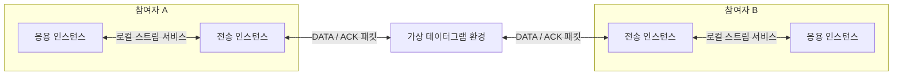

# 계층 연결 프로토콜 스택 설계

상태: Accepted
기준일: 2026-11-06
구현 상태: [S1 모델·검사·바이트](s1-stack-models.md)·[S2 실행 코어](s2-stack-runtime.md)·[S3 ReliableStreamLite](s3-reliable-stream-lite.md)·[S4 저장/관찰 API](s4-stack-persistence-observation.md)를 구현했다. [S5 화면·기본 저장 흐름](s5-stack-workspace.md)을 연결했다. 두 모드는 canonical v2 저장을 공유하고 스택 실행/분석과 저장/검사는 worker에서 처리한다. 최종 검증 상태는 구현 계획을 따른다.

## 문제와 목표

현재는 프로토콜 하나와 가상 하위 환경을 A/B 사이에서 실행한다. 응용 프로토콜이 전송 프로토콜을 실제로 사용하게 하려면 각 참여자에 독립적인 프로토콜 인스턴스를 여러 개 만들고, 로컬 서비스 포트와 참여자 사이 통신 링크를 분리해야 한다.

목표는 응용 메시지가 바이트로 인코딩되고, 전송 프로토콜의 분할·ACK·재전송·중복 제거를 거쳐 상대 응용에 전달되는 과정을 같은 실행에서 관찰하는 것이다. 서비스 종류·계층 역할·요청/응답 같은 통신 패턴은 별도로 유지한다.

이 문서는 [v1 설계](layered-protocol-v1.md)의 단일 계층 실행을 대체하지 않는 후속 설계다. 작업 순서·진행·실제 검증 결과는 [구현 계획](../exec-plans/completed/20261106-layered-protocol-stacks.md)이 소유한다.

### 첫 연결 버전의 범위

- A/B 두 참여자, 각 참여자의 응용·전송 인스턴스 하나씩, 총 네 인스턴스를 지원한다.
- 참여자 안에서는 위에서 아래로 이어지는 선형 스택, 참여자 사이에는 최하위 포트끼리 연결한 링크 하나를 지원한다.
- 첫 사용자 예제는 이미 준비된 가상 연결에서 양방향으로 동작하는 사용자 정의 `ReliableStreamLite`다. Stop-and-wait의 개념을 확장하며 TCP로 표시하지 않는다.
- Ping/Pong과 기존의 제한된 HTTP/1.1 응용 정의를 연결한다. 정의 재사용은 명시적인 v1 호환 경로로 수행한다.
- 상태도·시퀀스·설명·진단·중단점·시나리오 검증·커버리지·두 실행 비교·저장/재생까지 인스턴스 대상을 구분한다.

다중 연결·분기/합류 토폴로지·라우팅·세 계층 이상의 사용자 스택·실제 서버/기기·TLS·전체 TCP·혼잡/윈도 기반 흐름 제어·half-close/재연결 협상은 이번 범위 밖이다. 기본 예제의 준비 상태는 TCP 연결 수립을 수행했다는 뜻이 아니다.

## 현재 구현과의 차이

| 현재 경로·계약 | 확인한 현재 동작 | 필요한 확장 |
| --- | --- | --- |
| [프로토콜 모델](../../src/domain/protocol-model.ts) | `protocols.A/B`에 정의 하나씩 참조. 메시지 필드는 scalar, 타깃은 participant | 인스턴스·포트·바이트 값·연결·인스턴스별 시나리오/기대 조건 |
| [실행 엔진](../../src/engine/simulation.ts) | A/B가 각각 상태·변수·코덱·타이머를 소유. send는 환경으로, deliver는 관찰 목록으로 전달 | 규칙 실행과 전체 스케줄링 분리, 로컬 포트 전달 |
| [환경 포트](../../src/engine/environment-port.ts) | bytes/논리 packet의 전송과 전달을 표현. ACK 의미를 해석하지 않음 | 링크/최하위 인스턴스 주소 지정. 환경의 책임은 유지 |
| [생성 경로](../../src/application/create-simulation.ts) | 검증→snapshot→seeded 환경→`SimulationEngine` | 버전·mode에 따라 단일/스택 경로 조합 |
| [Stop-and-wait](../../src/examples/stop-and-wait.ts) | 문자열 payload 중심의 단방향 재전송 예제 | 바이트·양방향·분할/조립·상위 스트림 포트를 갖춘 별도 예제 |
| [TCP 연결 예제](../../src/examples/tcp-handshake.ts) | ESTABLISHED에서 finish. 데이터 전송용 상위 스트림이 없음 | 향후 별도의 데이터/서비스 제공 확장. 지금 HTTP의 하위 계층으로 지정할 수 없음 |
| [저장 모델](../../src/domain/workspace-model.ts) | workspace/bundle/schema 1과 v1 실행 snapshot | legacy 자료를 포함할 수 있는 명시적인 새 저장 형식 |

## 제안 구조와 계약

### 전체 연결과 모듈 책임

위 모든 인스턴스·로컬 전달·통신 링크는 하나의 가상 시계와 이벤트 큐를 사용한다. `SimulationEngine.run()`을 계층별로 중첩 호출하지 않는다.

| 제안 모듈 | 책임 | 소유하지 않는 책임 |
| --- | --- | --- |
| `ProtocolRuntime` | 인스턴스의 코덱·상태·변수·타이머와 규칙 평가·효과 준비 | 전역 시계, 다른 인스턴스 직접 실행 |
| `ServiceRouter` | 연결 확인, 유한 로컬 요청/통지 큐, 데이터 타입·포트 상태와 범위 확인 | 재전송·중복 제거·자동 신뢰성 추가 |
| `StackScheduler` | 단일 큐·시계·순번·seeded 환경, 실행 수명·원자적 효과 반영·전역 한도 | 응용/전송 메시지의 의미 추측 |
| `EnvironmentAdapter` | 최하위 링크의 패킷 전달·지연·손실·중복 | 상위 메시지/ACK 해석 |
| application 조합 계층 | 정의 검사·불변 snapshot·런타임/환경 조립·session fencing·저장 | 사용자 프로토콜 규칙 대신 실행 |

규칙 평가 코어를 분리할 때 v1의 큐/효과/trace 순서를 바꾸지 않는다. 공유 가능한 코어만 추출하고 단일 실행과 스택 실행의 버전별 조합 경로를 둔다. 현재 모듈은 [Architecture](../../ARCHITECTURE.md), 신규 경로 후보는 구현 계획을 따른다.

### 실험 데이터와 식별자

| 데이터 | 핵심 내용 |
| --- | --- |
| 정의 | 정확한 ID/revision, 기존 메시지·코덱·규칙, 요구 하위 포트·선택적 제공 상위 포트 |
| 인스턴스 | 참여자 안에서 유일한 stable instanceId, 정의 참조, 독립 초기 설정 |
| endpoint | `(participant, instanceId)`. 예: `A/app`, `A/transport`. 계층 이름이나 배열 순번을 ID로 쓰지 않음 |
| binding | 같은 참여자의 consumer 하위 포트→provider 상위 포트 |
| network link | linkId, 양쪽 최하위 endpoint/포트, 환경 정의 |
| StackExperiment | mode, nodes/instances, bindings, link, 사용 정의 전체, seed, 시나리오·한도 |
| StackSnapshot | 실험과 실제 정의/호환 adapter 내용·버전의 불변 사본, schema/engine/random 버전 |

같은 정의를 네 번 사용해도 런타임 상태는 공유하지 않는다. 인스턴스의 표시 순서/이름 변경은 ID를 바꾸지 않으며, 정의 교체·삭제·연결 변경은 새 초안 revision으로 재검증한다. 사용 중인 인스턴스를 삭제하려면 binding·입력·기대 조건의 참조를 먼저 정리한다. 과거 snapshot은 삭제/편집의 영향을 받지 않는다.

검사는 ID/revision·포트 존재와 방향·타입, 단일 provider, 끊긴 연결, 두 참여자의 선형 구조/개수, 최하위 링크, 양쪽 wire 코덱/메시지 계약을 확인한다. 순환은 로컬의 consumer→provider 의존 그래프에서 판단한다. read/write의 양방향 흐름 자체를 순환 연결 오류로 취급하지 않는다. A/B가 서로 다른 client/server 정의를 쓰는 경우에도 wire 계약이 호환되어야 한다.

### 서비스와 바이트 계약

| 서비스 | 요청 | 상위 통지·경계 |
| --- | --- | --- |
| `stream<bytes>` | write(bytes) | read(bytes). 쓰기/읽기·메시지 경계가 같다고 가정하지 않음 |
| `datagram<bytes>` | send(bytes) | receive(bytes). 데이터그램 하나의 경계 유지 |
| `datagram<packet-schema>` | send(packet) | receive(packet). 명시적인 논리 packet 스키마와 호환성 검사 |

bytes와 논리 packet 사이에 암묵적인 stringify/parse 변환을 넣지 않는다. 앱의 send는 그 앱 코덱의 실제 출력으로 하위 서비스를 요청한다. 전송 계층의 DATA payload는 이 바이트를 보존하고, 상위 read로 받은 바이트는 상대 앱의 기존 점진적 코덱에 입력한다. 앱 메시지 경계는 앱 코덱이 복원한다. 관련 개념은 [TCP 서비스](https://www.rfc-editor.org/rfc/rfc9293.html#section-2.2), [HTTP 바이트 파싱](https://www.rfc-editor.org/rfc/rfc9112.html#section-2.2)을 참고한다.

스택용 정의에는 bytes 필드·변수, 현재 서비스 payload 참조, byteLength·유한 slice·concat 표현식을 추가한다. 인덱스·길이·결과 크기를 검사하며 사용자 JavaScript는 제공하지 않는다. v1의 scalar/JSON 필드를 조용히 bytes로 재해석하지 않는다.

런타임 payload는 소유권이 제한된 바이트 저장소와 읽기 전용 handle로 취급한다. 저장/bundle의 바이트 값은 길이를 검증한 tagged base64 형태로 표현하고, 큰 trace payload는 실행 자료 안에 한 번 저장한 payloadId와 offset/length로 참조한다. 바이트의 불변성은 소유권·외부 mutable 참조 차단으로 보장한다. 변경 가능한 typed array를 공개하거나 `Object.freeze`만으로 불변이라고 가정하지 않는다.

payload 참조는 해당 저장 record 안에서 해석한다. 다른 실행의 같은 runId/eventId/payloadId를 공유 데이터나 공유 원인으로 취급하지 않는다. 두 실행의 내용 비교는 실제 값/유한 byte 비교 또는 명시적인 한도로 판단하며 payloadId의 같음으로 판단하지 않는다. 실제 인코딩 결과·수신 bytes를 보존하며 재생 때 현재 정의로 bytes를 재생성하지 않는다. base64는 저장 표현이고 사용자 정의 전송 패킷을 실제 TCP wire 형식으로 만드는 기능이 아니다.

관찰된 trace가 참조하는 payload는 불변 RunArtifacts의 소유로 남긴다. 완료/취소/초기화 때 live 큐·codec/provider 버퍼와 관찰되지 않은 임시 자료의 소유권은 해제하지만, 보존한 기록의 payload를 없애지 않는다. 취소된 부분 기록도 자료와 함께 원자적으로 capture/저장하고, 기록 삭제·보존 종료 뒤 참조가 없어졌을 때만 해당 자료를 해제한다.

서비스 종류·지원 요청/통지·준비/실패 의미는 선언된 계약이다. 정적 호환성 통과는 구현된 신뢰성의 증명이 아니다. 재전송·순서 보존·중복 제거는 provider의 실제 규칙과 검증 사례로 확인한다.

### 수락·준비·종료·실패

- write 수락은 유한 로컬 큐에 요청을 넣을 자원이 확보됐다는 뜻이다. 상대 수신·ACK·응용 처리 완료와 각각 구분해 기록한다.
- 첫 예제는 `initially-ready` 서비스다. 준비 상태를 snapshot의 초기 서비스 상태에 명시한다. 연결 수립을 모델링하는 향후 provider는 실제 규칙에서 ready를 통지해야 하며 ESTABLISHED라는 상태명만 보고 추정하지 않는다.
- provider는 서비스 요청을 새로운 규칙 이벤트로 받는다. 기존 send는 하위 wire 전송, 기존 deliver는 응용 메시지 관찰로 유지하고, 상위 read/failed/closed 통지는 별도의 서비스 효과로 표현한다.
- 요청 큐가 한도를 넘으면 `limit-reached`로 명시적으로 종료한다. 조용한 drop·무한 대기·성공 수락을 만들지 않는다. 가용량 기반 backpressure/재시도 협상은 후속 범위다.
- 재시도 소진 등 모델링한 전송 실패는 provider의 정상 실패 규칙과 failed 통지다. 상위는 실패 이벤트 또는 자신의 타이머로 처리하며 자동 성공/자동 전체 스택 finish를 만들지 않는다.
- 정상 closed를 제공하는 포트는 완성되지 않은 앱 프레임에 EOF 진단을 적용한다. failed는 이미 관찰한 접두부를 유지하고 미완성 해석을 중단한다. 첫 Lite 예제에는 TCP식 close/half-close/재연결 절차를 추가하지 않는다.
- finish는 해당 인스턴스에만 적용한다. 앱의 완료는 하위의 ACK·중복 처리나 시나리오 관찰을 종료하지 않는다. 계속 서비스해야 하는 provider는 최초 상위 전달/ACK에서 terminal이 되지 않게 정의한다.

### 결정적 실행과 원자성

큐 키는 `(timeMs, priority, globalSequence)`다. 시나리오 입력·로컬 전달·하위 전달·연결/서비스 통지는 같은 비타이머 우선순위, 만료는 그 뒤의 우선순위로 처리한다. 같은 시각에 새로 생긴 비타이머 전달도 타이머보다 앞서 처리한다. 순서를 바꾸면 stack engineVersion을 올린다.

로컬 전달은 기본 지연 0인 별도 큐 작업이다. 송신 규칙을 반영하기 전에 다른 인스턴스를 실행하지 않는다. 수신의 점진적 코덱이 여러 메시지를 만들면 그 수신 처리 경계 내에서 대상 인스턴스의 규칙을 처리한다. 하위/상위로 보내는 추가 효과는 모두 다음 큐 작업으로 예약한다. `step`과 live 중단점은 큐 처리 경계, history 중단점은 저장 이벤트 경계를 유지한다.

조건/동작을 임시 상태에서 평가하고, 필요한 trace·큐·바이트 예산을 검사한 뒤 상태·타이머·효과를 반영한다. 스택 모드에서는 기록 한도로 전이 기록이 빠진 상태 변경이 생기지 않게 처리 단위의 예산을 예약한다. 예약 실패는 마지막 관찰을 보존한 `limit-reached`이며, v1의 기존 자원 종료 trace는 새 의미로 다시 쓰지 않는다.

타이머 키는 `(participant, instanceId, timerId, generation)`이다. 취소/재시작·해당 인스턴스 종료는 그 키의 이전 만료를 무효화한다. reset/cancel은 live 큐·버퍼·타이머·임시 payload 소유권을 정리하고 run/session generation으로 늦은 callback을 차단한다. 기록된 payload는 RunArtifacts 수명을 따른다.

난수는 첫 버전의 링크 환경 하나만 소비한다. 동일한 bottom transmission에 대한 기존 특정 손실 우선·4회 draw 순서를 유지한다. 전송 번호와 특정 손실 키는 `(linkId, direction, transmission)`으로 확장하며 재전송·ACK도 실제 전송 번호를 소비한다. seed만으로 중간 실행을 복원하지 않고 같은 인스턴스를 계속하거나 snapshot으로 처음부터 재실행한다.

### 유한 자원과 관찰 종료

아래는 스택 모드의 초기 설계 한도이며 구현/브라우저 검증 전의 보증이 아니다. 기존 v1의 한도를 변경하지 않는다.

| 항목 | 스택 모드 설계 한도 |
| --- | --- |
| 참여자/인스턴스 | A/B, 각 2개, 총 4개 |
| 처리 작업·대기 큐 항목·trace 이벤트 | 각각 실행 전체 10000개. 계층 수만큼 곱하지 않음 |
| 메시지·codec 수신 버퍼·포트별 대기 데이터 | 각각 최대 1 MiB |
| 실행 내 고유 payload 바이트 | 최대 8 MiB, 공유 handle로 참조하는 동일 블록은 중복 저장하지 않음 |
| 살아 있는 codec/provider/포트 버퍼 논리 데이터 | 총 8 MiB. 각 소유자의 참조 범위를 합산해 관리 |
| 저장할 trace와 payload 자료 | 합계 16 MiB. 인덱스만 세고 payload를 제외하지 않음 |
| workspace/bundle·기록/사례 수 | 기존 64 MiB·100개 기록·20개 사례 한도 유지 |

바이트 snapshot/bundle 크기는 base64 표현을 포함한 실제 직렬화 크기로 검사한다. 반복된 0ms 전달·무한 재시도·미완성 프레임·큰 concat도 같은 전역 한도 안에서 정지해야 한다. 한도를 조정하려면 원인·측정·snapshot 한도를 함께 기록하며 기존 응답성 기준을 완화하지 않는다.

관찰은 scenario.observationMs까지 유지한다. 앱 완료·큐 비움·write 수락만으로 관찰을 조기 통과시키지 않는다. 모델링한 실패 상태는 기대 조건으로 검증할 수 있지만 취소·자원 종료·엔진 내부 오류는 성공으로 바꾸지 않는다. 규칙/해석 오류의 대상과 해당 서비스에 의존하는 영향을 기록하고, 영향을 받은 기대 조건은 미판정으로 남긴다. 오류 뒤 상위에 failed 통지를 보낼 수 있어도 이미 유효하게 관찰한 전이를 취소하지 않는다.

### 첫 사용자 예제

`ReliableStreamLite`는 DATA/ACK, 방향별 송신 대기·수신 순번, 재전송용 바이트 보관, 유한 재시도, 중복 억제를 가진 사용자 정의 전송 프로토콜이다. 이미 준비된 양방향 가상 서비스에서 시작하며 seq wraparound·혼잡 제어·윈도·TCP 헤더 호환성은 제공하지 않는다.

상위 write를 유한 버퍼에 보관하고 설정한 최대 chunk 크기로 나눈다. 각 방향은 한 DATA만 미확인 상태로 보내며 write 사이에도 seq를 이어간다. 수신자는 기대 순번의 DATA만 read로 올리고 ACK한다. 중복 DATA는 ACK만 다시 보내며, 미래 순번 DATA는 상위 전달·ACK 없이 명시적으로 무시한다. ACK는 대기 중인 방향·순번과 일치해야 한다. 설정한 정수 범위를 넘으면 진단하며 암묵적인 순번 재사용을 하지 않는다.

대표 관찰은 다음과 같다.

1. A/app의 메시지를 앱 코덱이 바이트로 만든다.
2. A/transport가 write를 받아 DATA 조각과 재전송 타이머를 만든다.
3. B/transport가 기대 조각을 한 번 올리고 ACK를 보낸다. B/app 코덱은 완전한 메시지가 될 때까지 누적한다.
4. 환경이 첫 ACK를 버린다. A/transport의 타이머가 같은 DATA 조각을 다시 보낸다.
5. B/transport는 중복 DATA에 ACK만 다시 보낸다. B/app에는 추가 바이트/중복 메시지가 전달되지 않는다.
6. 나머지 조각과 응답을 반대 방향으로 처리하고 응용 기대 조건을 판정한다.

HTTP 연결은 기존 제한된 HTTP/1.1 코덱과 범위로 검증한다. 현재 TCP 핸드셰이크와 기존 단방향 Stop-and-wait를 상위 스트림 provider로 자동 지정하지 않는다.

### 시나리오·기록·관찰 도구

시나리오의 입력/기대 조건은 endpoint를 명시한다. 일반 사용자 입력은 최상위 앱의 메시지로 제한하고, 하위 포트 직접 주입은 코어 테스트 fixture에서만 사용한다. 상태·완료 시간은 해당 인스턴스, 전달 메시지/횟수는 해당 앱의 deliver를 대상으로 한다. 서비스 read bytes·재전송/중복 억제 검사는 별도 포트 관찰로 구분한다.

trace는 원본 순서·run/event 식별자 외에 endpoint·portId·linkId·실제 서비스 요청/통지·규칙/전후 상태·payload 범위를 담는다. 로컬 수락→실제 포트 수신→해석→전이를 각각 구분한다. 분할/합쳐 읽기/재조립에는 실제 기여한 복수 sourceEventIds와 바이트 범위를 기록하며 값이 같다는 이유로 원인을 연결하지 않는다.

모든 도구는 frozen snapshot과 history prefix를 사용한다. 타깃이 없거나 형식/버전/계산 한도가 맞지 않으면 명시적인 미지원/제한을 표시한다.

| 기능 | 스택 모드 계약 |
| --- | --- |
| 상태도·변수·실행 설명 | endpoint의 정의·직접 trigger·실제 before/after만 사용 |
| 시퀀스·그림 연동 | A/app→A/transport→링크→B/transport→B/app을 구분. 압축 보기에서도 원본 인과관계 보존 |
| 메시지 구조 | 실제 앱 bytes·전송 패킷/논리 payload·수신 청크를 구분. 없는 wire를 재생성하지 않음 |
| 중단점 | endpoint를 포함해 compile. live 처리 원자성·history 이벤트 단위·후속 관찰 표시 유지 |
| 반복/회귀 | 모든 정의·bindings·link를 공통 source로 고정. 사례 소유 입력/환경/seed와 엔진 계약 비교 유지 |
| 커버리지 | endpoint별 초기/committed 전이만 집계. 미관찰·부분/누락/제외를 구분 |
| 두 실행 비교 | stable endpoint/서비스/대상으로 대응. 다른 토폴로지·v1/v2 사이에는 임의의 계층/회차 매칭을 하지 않음 |

### 화면 구성

새 ‘스택 구성’에서 A/B 인스턴스 카드·상/하위 포트·로컬 연결·최하위 링크를 편집한다. 포트 타입·참조 오류를 해당 카드/연결로 이동시킨다. 폼을 정식 편집 소유자로 유지하며 첫 버전부터 자유 그래프 drag/drop을 요구하지 않는다.

실행에는 endpoint 선택과 전체/계층별 시퀀스, 선택 인스턴스의 상태도·변수·포트 상태·버퍼 사용량을 둔다. 서비스 수락, 패킷 도착, 앱 메시지 해석/처리 완료를 다른 문구/모양으로 표시한다. 390px에서는 카드와 상세를 쌓고 시퀀스/표는 기존 내부 스크롤·페이지를 사용한다.

## 저장·호환성과 전환

실험·snapshot·trace·저장 envelope/bundle은 legacy와 stack을 명시적으로 구분하는 v2 형식을 둔다. 스택 engineVersion은 v1과 다르다. legacy 정의/실험/기록은 원래 schema·실제 설정·bytes·trace 순서를 보존하고 버전별 reader/실행 경로를 유지한다. v1 기록을 네 인스턴스가 실행된 자료로 변환하지 않는다.

v1 앱 정의를 사용할 때는 codec과 lowerService로 타입이 확인되는 요구 포트만 제공하는 버전 있는 호환 adapter를 snapshot에 포함한다. 상위 서비스가 없는 기존 전송 정의를 stream provider로 승격하지 않는다. 알 수 없는 버전은 요약/읽기 전용 제한을 표시하고 재실행을 차단한다.

저장 전환은 S4에서 다음 정책으로 구현한다.

1. DB 새 버전은 v2 store와 legacy store를 구분한다. 최초 upgrade transaction에서 v1 자료를 검사하고 legacy 원본을 보존한 채 v2 표현을 생성한다. legacy 항목 자체는 다시 해석하거나 덮어쓰지 않는다.
2. upgrade/최초 저장 실패·quota·검증 오류는 transaction 전체를 취소해 이전 DB/자료를 유지한다. 추가 보관 공간이 필요함을 저장 실패/내보내기 경로로 처리한다.
3. upgrade 뒤 구형 앱은 해당 DB에 쓰지 못하게 한다. 새 앱은 versionchange/blocked를 안내하고 탭 충돌·revision CAS를 유지한다. legacy/v2를 독립적인 writable 원본으로 동시에 운영하지 않는다.
4. 복구는 새 앱에서 legacy 보관본을 읽거나 v1 bundle로 내보내는 경로다. DB 버전을 조용히 되돌리거나 최신 자료를 자동 삭제하지 않는다. v1 내보내기에 stack 항목을 조용히 누락하지 않는다.
5. bundle은 정의·전체 토폴로지·해당 record의 payload 자료를 포함한다. 참조/범위/바이트 길이·크기·버전 전체를 staging 검증한 뒤 원자적으로 적용한다. 사본 import와 충돌 복구는 local endpoint/원인/payload 참조를 보존한다.

## 실패와 복구

| Flow | 실패 시 응답 | 내부 상태·stale/중복 방지 | 복구 |
| --- | --- | --- | --- |
| 연결/정의 실행 | endpoint·포트·JSON Pointer 진단, 시작 거부 | snapshot 생성 전 전체 검사, 기존 실행 유지 | 초안 수정 후 새 실행 |
| 규칙/코덱 오류 | 해당 endpoint 오류·서비스 실패 영향과 기대 조건 미판정 | rollback·미관찰 전이 추정 금지, 다른 인스턴스와 상태 격리 | snapshot 재실행 또는 새 초안 |
| 재전송·중복 DATA | 명시한 timer/seq 규칙으로만 처리 | 방향·대기 seq·generation·실제 수신 사본 기록 | 유한 재시도 또는 failed 통지 |
| 버퍼/큐/기록 상한 | limit-reached·미판정·마지막 관찰 | 실행 전체 예산 예약, 이후 작업 중단 | 크기/조건 조정 후 새 실행 |
| 취소/reset/새 snapshot | cancelled 또는 새 실행 | 전체 generation 변경, live 큐·버퍼 해제와 기존 기록 자료 보존 | 보존 기록 조회 또는 처음부터 재실행 |
| 저장 upgrade/import | 오류 위치·미저장·내보내기/재시도 | atomic transaction/staging·CAS·구형 writer 차단 | 보관 legacy/new 자료를 명시적으로 복구 |
| 관찰 도구 한도/버전 | limited/unavailable | 원본/prefix 밖으로 추정하지 않음 | 지원 버전 또는 제한된 원본 탐색 |

## 대안과 선택 이유

- 독립 엔진을 중첩 실행하는 방식은 시계·동시 타이머·중단점·원인 순서를 조정하기 어렵다. 단일 scheduler와 큐 전달을 사용한다.
- 계층 번호만 맞추는 연결 대신 서비스/자료형/방향을 검사한다. 응용=stream, 전송=특정 통신 패턴으로 고정하지 않는다.
- router에 자동 신뢰성을 넣으면 프로토콜 규칙의 결함을 가린다. router는 전달·예산만 소유하고 실제 보장은 provider 규칙으로 검증한다.
- 전체 TCP 대신 제한된 사용자 정의 provider로 첫 연결을 검증한다. TCP 데이터 서비스·연결/종료 확장은 별도 후속 설계다.
- 한 번에 임의 토폴로지를 제공하는 대신 두 계층·한 링크로 시작한다. 데이터 모델의 stable endpoint는 유지하되 아직 지원하지 않는 구성을 거부한다.

## 영향과 검증 시나리오

새 서비스·바이트 타입, 실행 생성/엔진, workspace/bundle과 DB upgrade, 모든 관찰 도구에 영향이 있다. 외부 API·소켓·credential·배포·신규 production dependency는 이 설계의 요구사항이 아니다. 구체적 신규 dependency가 필요해지면 기존 승인 규칙을 따른다.

검증은 구현 계획의 단계별 기준을 따른다. 특히 정상 왕복, ACK 손실의 한 번 전달, 중복/지연 역전, UTF-8/HTTP 경계 분할·합쳐 읽기, 동명 timer의 계층 격리, 정확한 deadline, ready/failed/EOF, 0ms/용량 한도, 취소 후 callback, frozen snapshot/prefix, v1 기록/재실행·DB upgrade 실패와 충돌을 포함한다. 현재 이 시나리오를 실행하거나 통과한 것으로 주장하지 않는다.

## 위험과 후속 작업

핵심 위험은 서비스 선언과 실제 구현의 혼동, DATA/ACK/응용 완료의 혼동, 계층별 payload 복제, v1 의미 변경, 초기 DB 전환의 자료 손실이다. 제한된 범위·명시적인 이벤트/버전·전역 예산·불변 자료·복구 가능한 저장과 단계별 회귀 검증으로 관리한다.

지원 범위를 확대하거나 준비/닫기·예산·직렬화 계약을 바꿀 때는 이 설계와 해당 단계 계획을 같은 변경에서 갱신한다. 성능 상한은 구현 후 실제 Chromium/Firefox와 [P7](p7-validation.md) 기준으로 확인하며 본 문서만으로 지원/성능을 보증하지 않는다.
